# Maktab | مكتب

**A free, open-source desktop office suite by [Woosool](https://woosool.com).**

[English](#english) · [العربية](#العربية) · [Français](#français)

> **Project status:** In development. Features and platform support will be documented as they become available.

---

## About Maktab

**Maktab** is an open-source desktop productivity project from **Woosool**, designed to make everyday office work accessible to everyone. Our goal is a simple, multilingual workspace for creating and editing documents, spreadsheets, and presentations.

Maktab is intended to be free for personal use, with source code published under the **MIT License**.

### Vision

- **Open and accessible:** Free software with publicly available source code.
- **Desktop-first:** A focused experience for everyday office tasks.
- **Multilingual:** Designed with Arabic, French, and English users in mind, including right-to-left language support as the project evolves.
- **Community-driven:** Contributions, bug reports, translations, and ideas are welcome.

### Planned scope

| App | Folder | Purpose |
| --- | --- | --- |
| Qalam قلم | `qalam/` | Write and edit documents (.docx) |
| Jadwal جدول | `jadwal/` | Organize and analyze spreadsheets (.xlsx, .csv, .ods) |
| Sard سرد | `sard/` | Create and present slides (.pptx) |
| Saboura سبورة | `saboura/` | Whiteboard: sticky notes, diagrams, mind maps (.sab) |
| Waraq ورق | `pdf/` | View, annotate, sign and edit PDFs |
| Barid بريد | `barid/` | Email |

### Screenshots

Every app speaks English, French and Arabic; in Arabic the whole interface runs right to left.

| | English | Français | العربية |
| --- | --- | --- | --- |
| **Qalam قلم** | 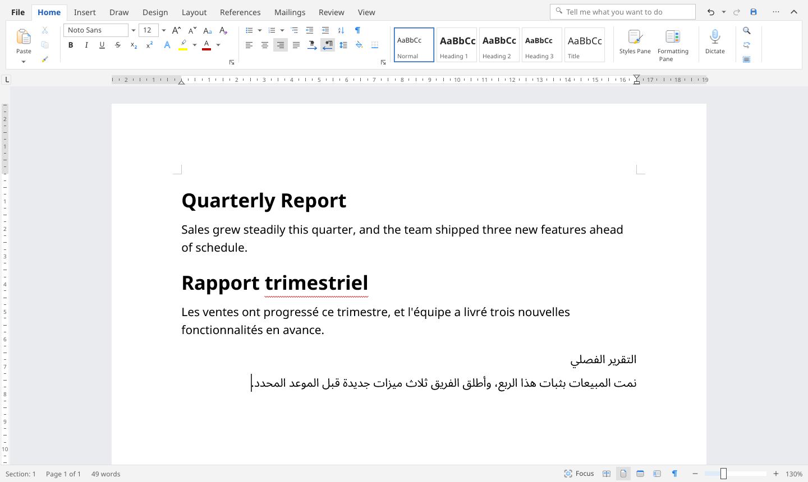 | 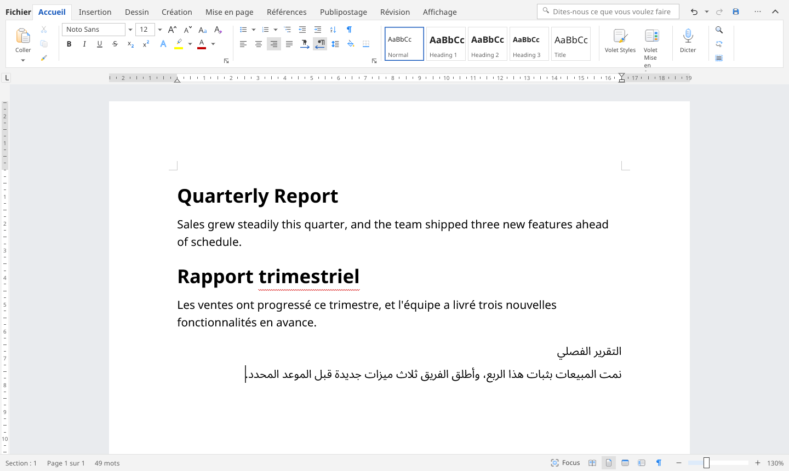 | 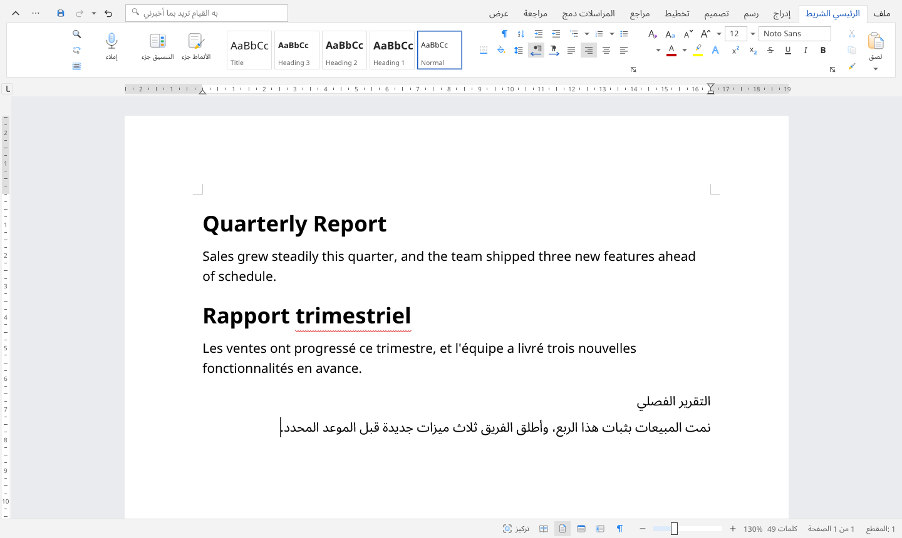 |
| **Jadwal جدول** | 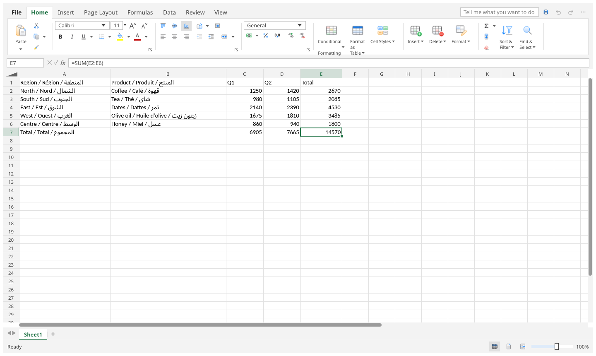 | 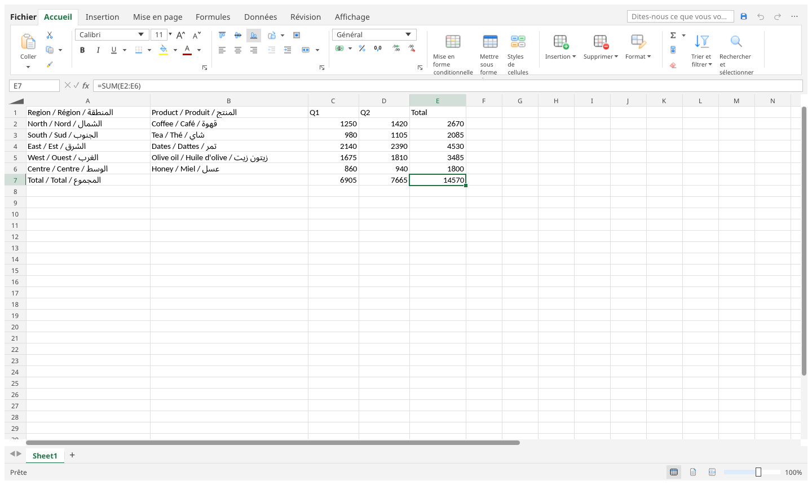 | 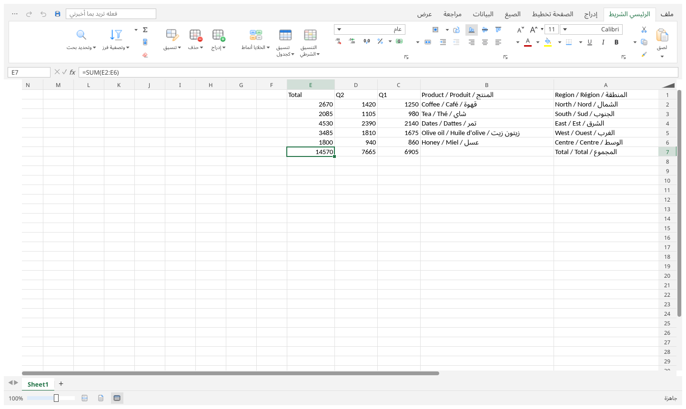 |
| **Sard سرد** | 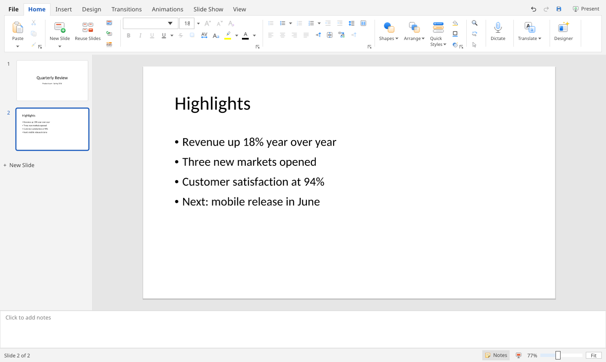 | 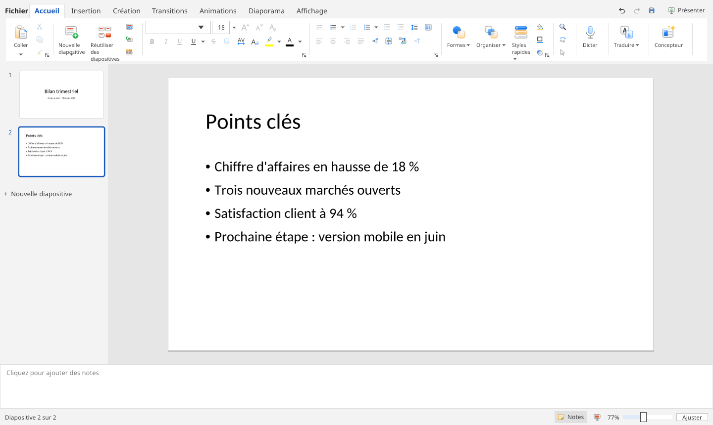 | 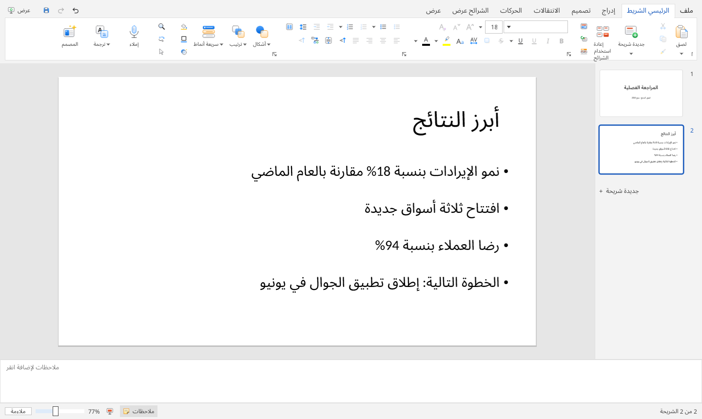 |
| **Saboura سبورة** | 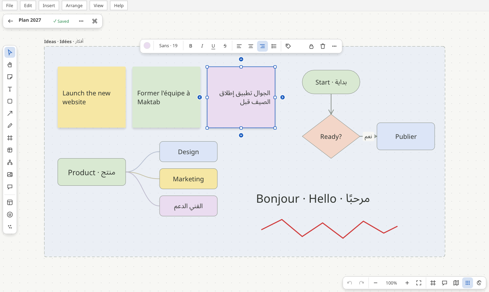 |  | 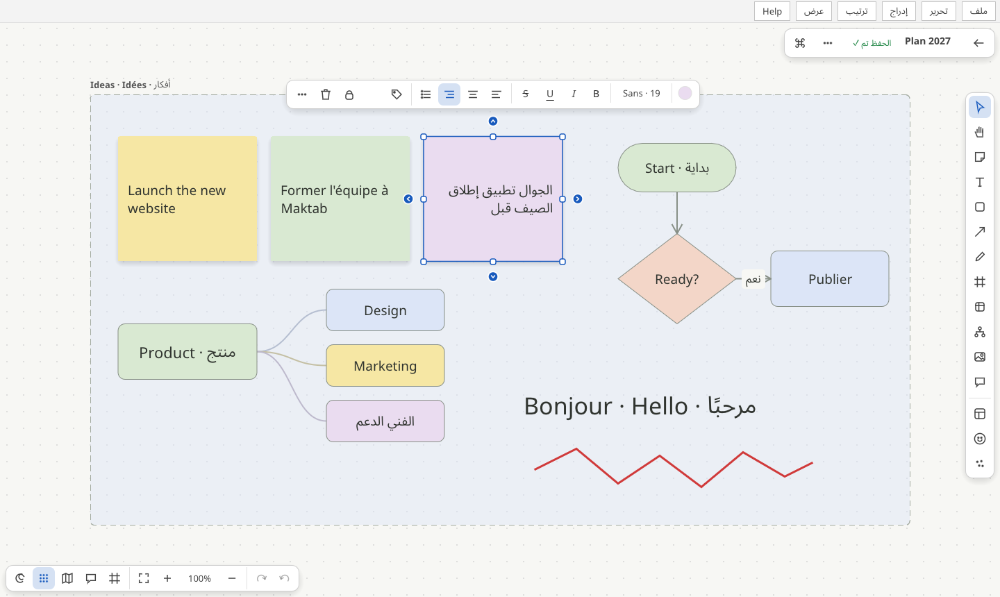 |
| **Waraq ورق (PDF)** | 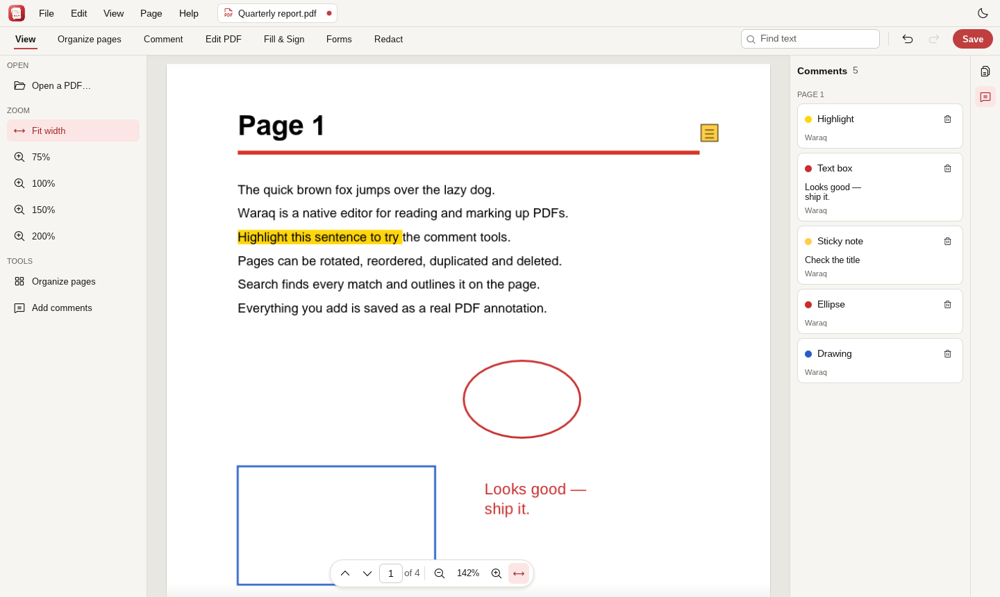 | 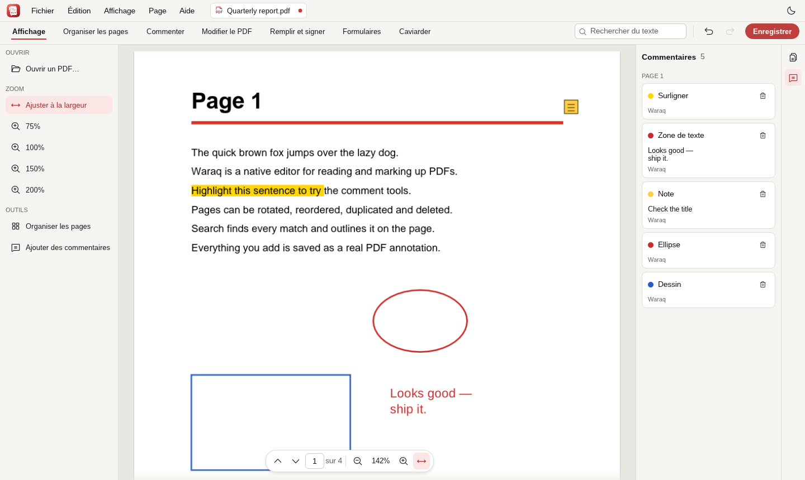 | 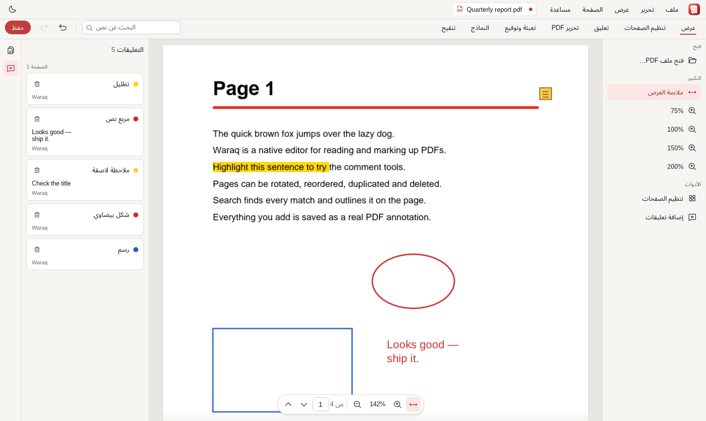 |
| **Barid بريد** | 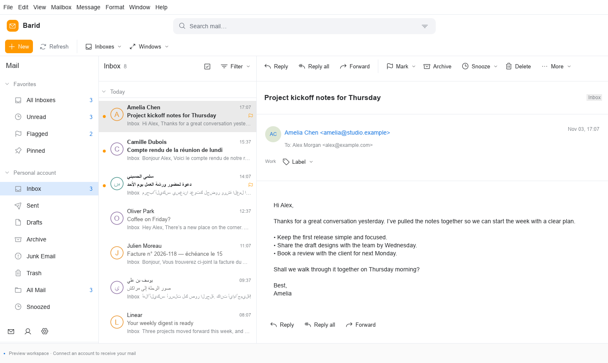 | 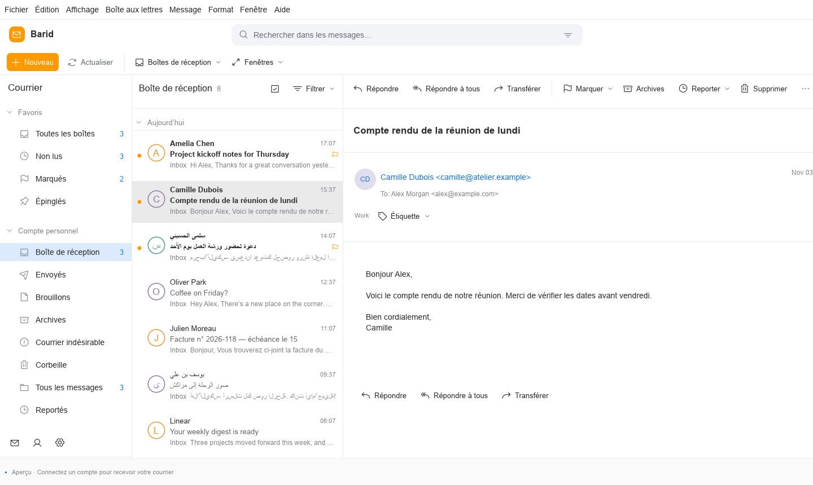 | 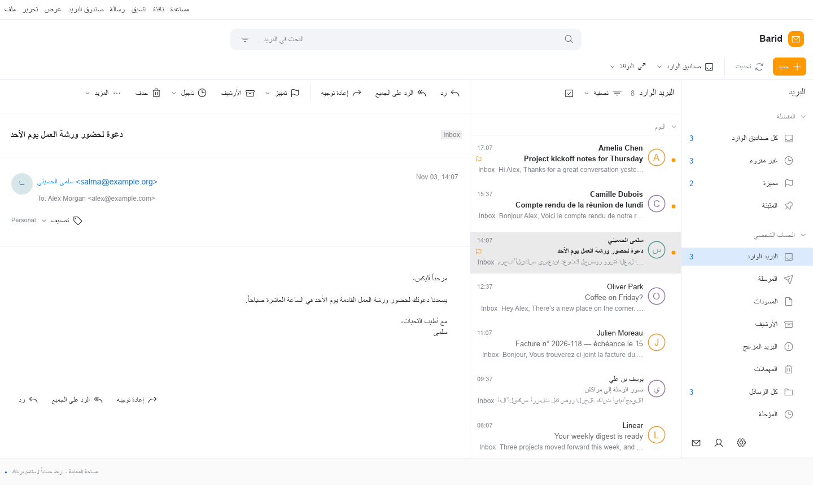 |

The screenshots are the real apps rendered by their tests: run `cargo test readme_screenshots -- --ignored`
in an app's folder with `MAKTAB_SCREENSHOTS=docs/screenshots` (an absolute path) to refresh them.

Shared code lives in `kit/` (interface) and `translate/`. All the apps carry the same version
(0.1.1); `tools/maktab/version.sh` prints it.

### Getting started

Run any app from its folder, e.g. `cd qalam && cargo run --release`.

**Maktab bundles** (every app in one download per platform) are built by
`.github/workflows/maktab.yml`, or locally:

| Platform | Command | Result in `dist/maktab/` |
| --- | --- | --- |
| macOS | `sh tools/maktab/package-macos.sh [aarch64\|x86_64]` | `Maktab-<v>-macos-<arch>.dmg` |
| Windows | `powershell -File tools\maktab\package-windows.ps1` | `Maktab-<v>-windows-x86_64-setup.exe`, portable `.zip` |
| Linux | `sh tools/maktab/package-linux.sh` | `maktab_<v>_<arch>.deb`, portable `.tar.gz` |
| ChromeOS | (the Linux `.deb`, installed in ChromeOS's Linux environment) | `Maktab-<v>-chromeos-<arch>.deb` |

The apps in a bundle are listed in `tools/maktab/apps.tsv`. Each bundle also holds every app's
update archive, and a release writes each app's `<app>-update.json`, so the apps' own
updaters keep working. Push a tag `maktab-v<version>` to publish a GitHub release. Maktab is the only
workflow: every push to `main` that touches an app builds all of them together.

### Installing without security warnings

The apps aren't signed with paid certificates yet (Apple Developer ID, a Windows code-signing
certificate), so a browser download is blocked or warned about. Installing from the command
line avoids that: files fetched by `curl` or PowerShell aren't marked as downloaded, so
Gatekeeper and SmartScreen don't step in.

- **macOS, Linux, ChromeOS** (Terminal):
  `curl -fsSL https://raw.githubusercontent.com/woosool/maktab/main/tools/maktab/install.sh | sh`
  (`--user` installs into your home folder on Linux without sudo; `--apps "Qalam Sard"` picks apps on macOS).
- **Windows** (PowerShell):
  `irm https://raw.githubusercontent.com/woosool/maktab/main/tools/maktab/install.ps1 | iex`
  (set `$env:MAKTAB_APPS = "qalam,sard"` first to pick apps).

The apps' own updaters download the same way, so updates open without warnings too. For a
browser download, the disk image includes "If an app won't open.txt" (System Settings ›
Privacy & Security › Open Anyway), and on Windows: More info › Run anyway.

**Signing later.** The workflows already sign whenever these secrets exist:
- *Windows, free:* [SignPath Foundation](https://signpath.org) signs open-source projects at no
  cost (apply with the repository; their certificate builds SmartScreen reputation). Or publish
  through the Microsoft Store (free individual developer account), which Microsoft signs.
  A certificate goes in `WINDOWS_CERTIFICATE` / `WINDOWS_CERTIFICATE_PASSWORD`.
- *macOS:* there's no free option; an Apple Developer account (USD 99 a year) gives the
  Developer ID and notarization (`MACOS_CERTIFICATE`, `MACOS_CODESIGN_IDENTITY`, `MACOS_NOTARY_*`).
  Until then the apps are ad-hoc signed, which Apple silicon needs to run them at all.

### Contributing

We welcome issues, feature suggestions, translations, documentation improvements, and code contributions. Please open an issue to discuss substantial changes before submitting a pull request.

### License

Maktab is released under the [MIT License](LICENSE). See the `LICENSE` file for the full terms. The MIT License permits personal and commercial use, modification, and redistribution, subject to its conditions.

### About Woosool

Maktab is a project by [Woosool](https://woosool.com), an ecosystem of productivity and collaboration tools.

---

## عن مكتب

**مكتب (Maktab)** مشروع مفتوح المصدر من **وصول (Woosool)** لتوفير مجموعة أدوات مكتبية للحاسوب، تساعد الجميع على إنجاز أعمالهم اليومية بسهولة. نطمح إلى تقديم بيئة متعددة اللغات لإنشاء المستندات والجداول الإلكترونية والعروض التقديمية وتحريرها.

يهدف المشروع إلى أن يكون **مجانيًا للاستخدام الشخصي ومفتوح المصدر بموجب رخصة MIT**.

### رؤيتنا

- **مفتوح ومتاح للجميع:** برنامج مجاني مع شيفرة مصدرية متاحة للعموم.
- **مصمم للحاسوب:** تجربة واضحة ومركزة على المهام المكتبية اليومية.
- **متعدد اللغات:** مع الاهتمام بالعربية والفرنسية والإنجليزية ودعم اتجاه الكتابة من اليمين إلى اليسار مع تطور المشروع.
- **بمساهمة المجتمع:** نرحب بالمساهمات، والإبلاغ عن الأخطاء، والترجمات، والأفكار.

### الأدوات المخطط لها

| الأداة | الوظيفة |
| --- | --- |
| المستندات | كتابة المستندات النصية وتحريرها |
| الجداول الإلكترونية | تنظيم البيانات وتحليلها |
| العروض التقديمية | إنشاء الشرائح وعرضها |

هذه الأدوات تمثل نطاق المشروع المستهدف، ولا تعني أن جميع الميزات متاحة حاليًا.

### البدء

ستُضاف تعليمات التثبيت وأنظمة التشغيل المدعومة وخطوات البناء مع تقدم التطوير.

### المساهمة

نرحب ببلاغات الأخطاء، واقتراحات الميزات، والترجمة، وتحسين التوثيق، والمساهمات البرمجية. يُفضّل فتح تذكرة نقاش قبل إرسال تغييرات كبيرة.

### الترخيص

يصدر مكتب بموجب [رخصة MIT](LICENSE). راجع ملف `LICENSE` للاطلاع على الشروط الكاملة. تسمح الرخصة بالاستخدام الشخصي والتجاري والتعديل وإعادة التوزيع وفقًا لشروطها.

### عن وصول

مكتب مشروع من [وصول](https://woosool.com)، منظومة من أدوات الإنتاجية والتعاون الرقمي.

---

## À propos de Maktab

**Maktab** est un projet bureautique de bureau libre et open source développé par **Woosool**. Son objectif est de rendre les outils de productivité accessibles à tous, grâce à un environnement simple et multilingue pour créer et modifier des documents, des feuilles de calcul et des présentations.

Maktab a vocation à être **gratuit pour un usage personnel et distribué sous licence MIT**.

### Notre vision

- **Ouvert et accessible :** un logiciel gratuit dont le code source est public.
- **Pensé pour l'ordinateur :** une expérience simple pour les tâches bureautiques quotidiennes.
- **Multilingue :** conçu pour les utilisateurs arabophones, francophones et anglophones, avec une prise en charge progressive de l'écriture de droite à gauche.
- **Communautaire :** contributions, signalements de bugs, traductions et suggestions sont les bienvenus.

### Fonctionnalités prévues

| Outil | Fonction |
| --- | --- |
| Documents | Rédiger et modifier des documents texte |
| Feuilles de calcul | Organiser et analyser des données |
| Présentations | Créer et présenter des diapositives |

Ce tableau décrit les objectifs du projet, sans garantir que toutes les fonctionnalités sont déjà disponibles.

### Premiers pas

Les instructions d'installation, les systèmes compatibles et les étapes de compilation seront ajoutés au fil du développement.

### Contribuer

Vous pouvez participer en signalant des problèmes, en proposant des fonctionnalités, en traduisant, en améliorant la documentation ou en contribuant au code. Pour les changements importants, merci d'ouvrir d'abord une issue.

### Licence

Maktab est publié sous [licence MIT](LICENSE). Consultez le fichier `LICENSE` pour les conditions complètes. Cette licence autorise les usages personnels et commerciaux, la modification et la redistribution, sous réserve de ses conditions.

### À propos de Woosool

Maktab est un projet de [Woosool](https://woosool.com), un écosystème d'outils de productivité et de collaboration.
